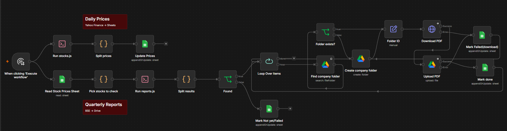

# Stock Tracker & Quarterly Results Automation (n8n + Node.js)

An n8n workflow that keeps a Google Sheet updated with daily prices for a watchlist of 20 NSE stocks, and
automatically downloads each company's quarterly results PDF from BSE into Google Drive as soon as it's
published, with the link written back to the sheet.



## What it does

One trigger runs two independent branches, so a problem with one data source never stops the other.

**Daily prices** (Yahoo Finance → Google Sheets)

```
Run stocks.js → Split prices → Update Prices (append or update by stock_code)
```

For each stock: today's price vs the previous trading day, change and change %, trend (Up / Down /
No change), buying or selling pressure, day high/low, volume and last-updated time. Weekends and market
holidays are handled by always comparing the last two trading days.

**Quarterly results** (BSE → Google Drive → Google Sheets)

```
Read Stock Prices Sheet → Pick stocks to check (skip ones already Done this quarter)
   → Run reports.js → Split results → Found?
        ├── Found → Loop over each stock:
        │      Find company folder → Folder exists? (create if not) → Download PDF → Upload PDF → Mark done
        │      (download/upload errors → Mark Failed, loop continues)
        └── Not yet / Failed → Mark Not yet/Failed
```

- Works out the **current results quarter** automatically (for example Q2FY27) and resets every stock to
  "Not yet" when a new quarter begins.
- Only checks stocks that are **Not yet** or **Failed**, so repeat runs are fast and never download duplicates.
- Picks the real results filing out of dozens of announcements (accepts the Result category or a Board
  Meeting outcome, ignores intimations, transcripts and press releases) and **prefers consolidated** results.
- Saves PDFs as `CODE_QxFYyy.pdf` in **one Google Drive folder per company**, creating folders as needed.

## Sheet columns

| Columns | Filled by |
|---|---|
| `stock_code, stock_name, today_date, price_today, yesterday_date, price_yesterday, change, change_pct, trend, pressure, day_high, day_low, volume, updated_at` | Daily prices branch |
| `report_quarter, report_status, report_date, report_title, report_link` | Quarterly results branch |

`report_status` is Done, Not yet or Failed.

## Reliability

- 2-second pauses between BSE requests and up to 4 automatic retries
- Checks both BSE folders (`AttachLive` for new filings, `AttachHis` for archived ones)
- PDF download timeout and retries in n8n, with an error branch that marks the stock **Failed** and moves on
- Failed stocks are retried automatically on the next run

## Files

| File | Purpose |
|---|---|
| `workflow.json` | The n8n workflow |
| `stocks.js` | Fetches daily prices from Yahoo Finance and prints JSON |
| `reports.js` | Finds quarterly results filings on BSE and prints JSON |
| `package.json` | Project info (no extra libraries needed, Node.js 18+) |

## Setup

1. Copy `stocks.js` and `reports.js` to a folder on the machine running n8n (the workflow uses `C:\scraper\`;
   change the path in the two **Execute Command** nodes if yours differs).
2. Test them: `node stocks.js` and `node reports.js INFY`.
3. Enable the Execute Command node, which n8n 2.x disables by default:
   start n8n with `NODES_EXCLUDE=[]`.
4. Import `workflow.json` into n8n and connect your Google Sheets and Google Drive credentials.
5. Create a sheet tab with the columns above and replace `YOUR_SPREADSHEET_ID` (or reselect the sheet).
6. Create a **Stock Reports** folder in Google Drive and replace `YOUR_STOCK_REPORTS_FOLDER_ID` with its ID.
7. Set the workflow timezone to Asia/Kolkata in **Settings**.

To change the watchlist, edit the `STOCKS` list in `stocks.js` and the `BSE_CODES` list in `reports.js`.

## Notes

Data comes from public Yahoo Finance and BSE endpoints that aren't official APIs, so they may change or
limit requests. Prices may be delayed. For personal and educational use; not investment advice.
